Quality Inspector | Manufacturing Quality • Medical Devices • Quality Analytics • Technology

I'm a manufacturing quality professional with experience across high-voltage transformer components, robotic surgical systems, medical devices, and appliance manufacturing.

Currently working at Hyosung HICO, I apply quality inspection principles while expanding my technical skills through hands-on projects involving Python, JavaScript, data analytics, and interactive manufacturing simulations.

My portfolio connects practical manufacturing experience with technology, exploring statistical process control (SPC), measurement system analysis (MSA), root cause analysis, CAPA, process improvement, and quality decision-making.

**Professional Development:** Pursuing ASQ Certified Quality Inspector (CQI) certification, with a growing interest in robotics, automation, machine learning, and AI applications in manufacturing quality.

**Tech Stack**

| | |
|---|---|
| **Languages** |     |
| **Data & Analytics** |     |
| **Tools & Hosting** |        |
| **Standards** |     |
| **Quality Methods** |         |

---

**Quality analytics apps**

| Project | What it does | Live |
|---|---|---|
| [gage-rr-msa](https://github.com/MarusFaulkner/gage-rr-msa) | Gauge R&R / MSA per AIAG: ANOVA and Average & Range, %GRR, ndc, control charts. Verified against the AIAG reference example. | [App](https://gage-rr-msa.streamlit.app) |
| [supplier-receiving-inspection](https://github.com/MarusFaulkner/supplier-receiving-inspection) | Incoming inspection on SAP MM/QM-style data: supplier scorecard, SCAR and skip-lot flags, defect Pareto, QI stock aging, MB51 reconciliation. | [App](https://supplier-receiving-inspection.streamlit.app) |
| [ncr-description-assistant](https://github.com/MarusFaulkner/ncr-description-assistant) | Scores NCR defect descriptions for condition, location, and quantity; flags cause speculation. Reports honest held-out accuracy and has a Python/JS parity test. | [App](https://huggingface.co/spaces/MarusFaulkner/ncr-description-assistant) |
| [manufacturing-quality-dashboard](https://github.com/MarusFaulkner/manufacturing-quality-dashboard) | SPC, capability, RCA, CAPA, and predictive quality on synthetic process data. | [App](https://manufacturing-quality-dashboard.streamlit.app/) |
| [ncr-analytics](https://github.com/MarusFaulkner/ncr-analytics) | NCR trends, aging, disposition, and severity analysis. | [App](https://ncr-quality-analytics.streamlit.app/) |
| [interactive-a3-continuous-improvement](https://github.com/MarusFaulkner/interactive-a3-continuous-improvement) | A3 problem solving: current condition, 5 Whys, countermeasures, effectiveness check. | [App](https://interactive-a3-continuous-improvement.streamlit.app/) |
| [value-stream-map](https://github.com/MarusFaulkner/value-stream-map) | Live value stream map with takt time, breakdowns, queues, and future-state pull. | [Demo](https://marusfaulkner.github.io/value-stream-map/) |
| [manufacturing-root-cause-analysis](https://github.com/MarusFaulkner/manufacturing-root-cause-analysis) | Pareto, fishbone, 5 Whys, CAPA, and verification on a fictional dimensional nonconformance. | [Demo](https://marusfaulkner.github.io/manufacturing-root-cause-analysis/) |
| [quality-calibration-checker](https://github.com/MarusFaulkner/quality-calibration-checker) | Checks gauge calibration status and tolerance limits before accepting a measurement. | [App](https://quality-calibration-checker.streamlit.app) |
| [ncr-dashboard](https://github.com/MarusFaulkner/ncr-dashboard) | Browser NCR tracker built around ISO 9001:2015 workflow. | [Demo](https://marusfaulkner.github.io/ncr-dashboard/) |
| [automated-visual-inspection-simulator](https://github.com/MarusFaulkner/automated-visual-inspection-simulator) | Simulated vision inspection: defect classification, PASS/FAIL, yield. | [Demo](https://marusfaulkner.github.io/automated-visual-inspection-simulator/) |

**Information systems**

- **[patient-health-tracker](https://github.com/MarusFaulkner/patient-health-tracker)** — Healthcare information-systems demo: synthetic patient records, vital-sign charts, and rule-based alerts. ([Demo](https://marusfaulkner.github.io/patient-health-tracker/))
- **[network-security-dashboard](https://github.com/MarusFaulkner/network-security-dashboard)** — SOC-style dashboard simulation: event triage, asset inventory, risk prioritization, NIST CSF mapping. ([Demo](https://marusfaulkner.github.io/network-security-dashboard/))

All projects use synthetic data built to reflect real workflows, not production systems.

**Interactive quality games**

Lighter builds that round out the same skillset — JavaScript, UI, and deployment applied to quality concepts.

- **[Quality Quest](https://marusfaulkner.github.io/quality-quest/)** — Five-stage game from receiving inspection to shipping.
- **[Quality Rush: All Hands](https://marusfaulkner.github.io/quality-rush-all-hands/)** — Three-character manufacturing simulation covering prevention, inspection, and containment.
- **[Quality Rush: Containment Strike](https://marusfaulkner.github.io/containment-strike/)** — Warehouse containment challenge: identify suspect lots and prevent escapes.
- **[Quality Showdown](https://marusfaulkner.github.io/quality-showdown/)** — Survey-style game show about shop-floor quality.

---

**Connect:** [LinkedIn](https://www.linkedin.com/in/marcus-f-0a622b70) · [Resume](https://www.kickresume.com/cv/marcus-faulkner/) · [Portfolio site](https://marusfaulkner.github.io/)
