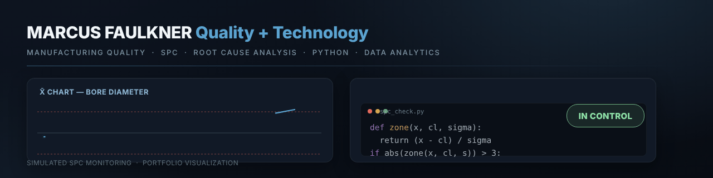

### Marcus Faulkner

Quality Inspector | Manufacturing Quality • Medical Devices • Quality Analytics • Technology

I'm a manufacturing quality professional with experience across high-voltage transformer components, robotic surgical systems, medical devices, and appliance manufacturing.

Currently working at Hyosung HICO, I apply quality inspection principles while expanding my technical skills through hands-on projects involving Python, JavaScript, data analytics, and interactive manufacturing simulations.

My portfolio connects practical manufacturing experience with technology, exploring statistical process control (SPC), root cause analysis, CAPA, process improvement, and quality decision-making.

**Professional Development:** Pursuing ASQ Certified Quality Inspector (CQI) certification, with a growing interest in robotics, automation, machine learning, and AI applications in manufacturing quality.

**Knowledge & Skills:** ISO 13485 • ISO 14971 • IEC 60601 • GD&T • SPC • CAPA • Root Cause Analysis (5 Whys, Fishbone, Pareto) • Python • Streamlit • JavaScript

---

**Portfolio projects**

- **[manufacturing-root-cause-analysis](https://github.com/MarusFaulkner/manufacturing-root-cause-analysis)** — Interactive quality case study: Pareto analysis, Fishbone, 5 Whys, CAPA, and effectiveness verification on a synthetic manufacturing defect.
- **[manufacturing-quality-dashboard](https://github.com/MarusFaulkner/manufacturing-quality-dashboard)** — Python/Streamlit dashboard integrating SPC, RCA, CAPA, and predictive quality on synthetic process data.
- **[value-stream-map](https://github.com/MarusFaulkner/value-stream-map)** — Live, interactive value stream map built in HTML/CSS/JS.
- **[interactive-a3-continuous-improvement](https://github.com/MarusFaulkner/interactive-a3-continuous-improvement)** — A3 problem-solving tool: current condition, 5 Whys, countermeasures, effectiveness verification.
- **[patient-health-tracker](https://github.com/MarusFaulkner/patient-health-tracker)** — Healthcare data dashboard with synthetic patient data and security-aware design.
- **[network-security-dashboard](https://github.com/MarusFaulkner/network-security-dashboard)** — Real-time threat detection and vulnerability assessment monitoring dashboard.

All projects use synthetic data built to reflect real quality workflows, not production systems.

**Interactive quality games**

Lighter builds that round out the same skillset — JavaScript, UI, and deployment applied to quality concepts.

- **[Quality Rush: All Hands](https://marusfaulkner.github.io/quality-rush-all-hands/)** — Three-character manufacturing simulation covering prevention, inspection, and containment.
- **[Quality Rush: Containment Strike](https://marusfaulkner.github.io/containment-strike/)** — Warehouse containment challenge: identify suspect lots and prevent escapes.
- **[Quality Showdown](https://marusfaulkner.github.io/quality-showdown/)** — Interactive manufacturing quality trivia.

---

**Connect:** [LinkedIn](https://www.linkedin.com/in/marcus-f-0a622b70) · [Resume](https://www.kickresume.com/cv/marcus-faulkner/) · [Portfolio site](https://marusfaulkner.github.io/)
